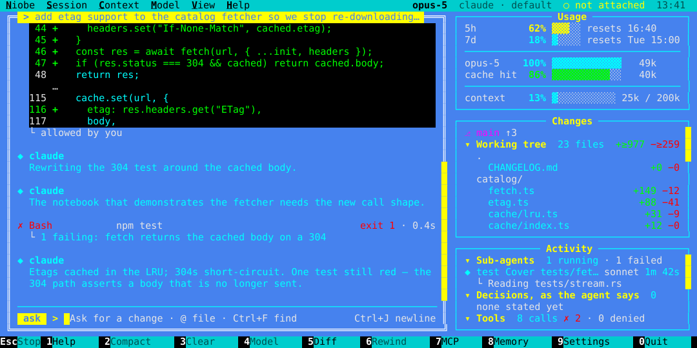
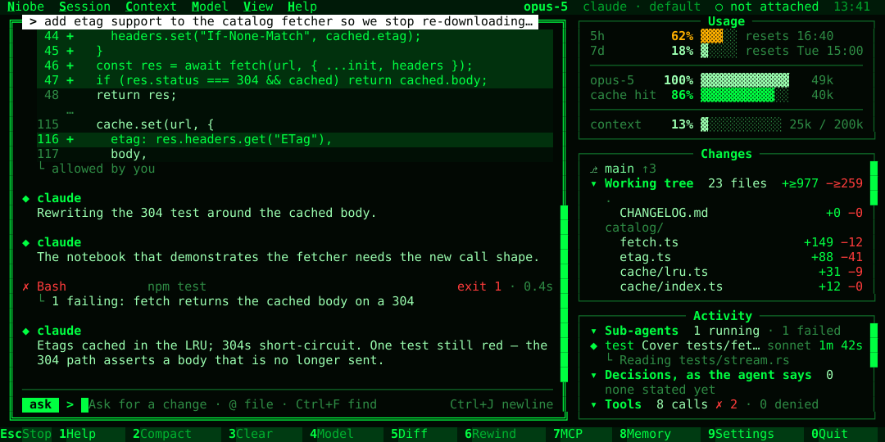
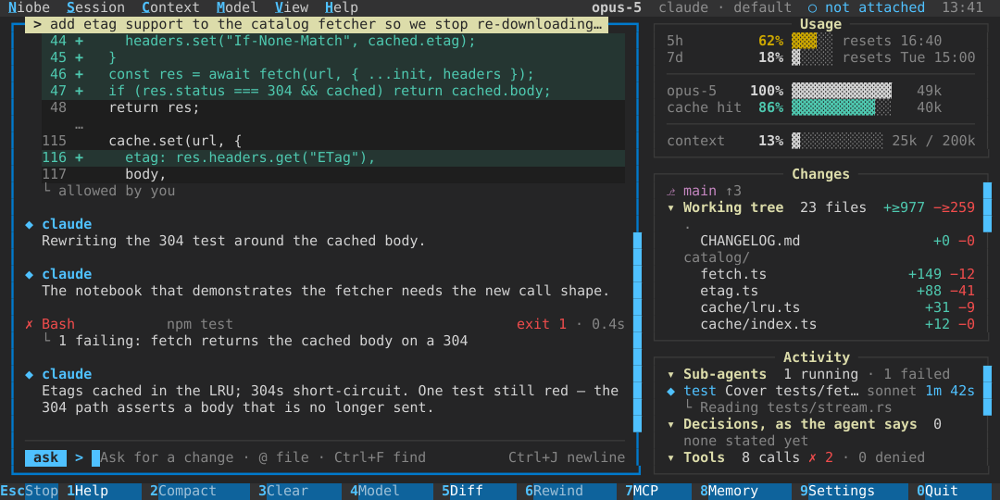

<!--
SPDX-License-Identifier: Apache-2.0
Copyright (c) Viacheslav Shynkarenko
-->

# Niobe

A terminal coding agent that keeps you aware of what is being built and how: what the agent
did, decided and touched, what it is doing now and what it cost, on screen while it happens.
Every cost figure is either one the backend reported or labelled as an estimate; where there
is no figure, the screen shows an em dash.


The same session in the other themes — `classic`, `neo` and `modern`, chosen with `--theme`:

| classic | neo | modern |
| --- | --- | --- |
|  |  |  |

These pictures are drawn by the shell's own snapshot tests, so they show what the code draws
today. `classic` is drawn in the sixteen colours your terminal's scheme gives it; the pictures
use xterm's.

Niobe drives the official `claude` CLI as a subprocess, so a session runs on whatever that CLI
is already signed in with. Niobe never reads the CLI's credential files and makes no network
calls of its own. Profiles for the `codex` CLI can be written, but that bridge does not start
the CLI yet, so a session under one has nowhere to send a prompt and says so.

## What Niobe is, and is not

Niobe keeps the official harness and adds awareness: the `claude` CLI does the work, and Niobe
draws what it did, decided and touched, and what that cost, while it happens, without asking you
to approve every step.

It is not an IDE, not a proxy in front of a provider, and not a new agent loop: it starts the
CLI you already have and reads what the CLI says. It does not read the CLI's credential files,
set a user agent or open a connection of its own; [SECURITY.md](SECURITY.md) names the check
that enforces each of those.

It is not Claude Code's own screen either. The CLI it drives says `/vim`, `/terminal-setup`,
`/statusline`, `/privacy-settings`, `/upgrade`, `/plugin`, `/add-dir` and `/tasks` are not
available there, and Niobe does not draw them in their place. `/fast` is refused by the CLI to a
session it is driven in. Claude Code's names for what Niobe has its own of open Niobe's views
instead: `/status` the settings, `/permissions` the standing answers, `/export` the transcript
export, `/bug` the bug report, `/login` and `/logout` the sign-in, and the rest F1 lists. A
command the CLI does not list, such as `/todos`, is held on the first Enter, since the CLI would
hand it to the model as text and spend a turn.

## Install

On macOS (arm64, x86_64) or Linux (x86_64, arm64):

```sh
curl -fsSL https://github.com/niobe-dev/niobe/releases/latest/download/install.sh | sh
```

The script checks the archive against the SHA-256 published beside it and puts `niobe` in
`~/.local/bin`; `NIOBE_INSTALL_DIR` puts it elsewhere and `NIOBE_VERSION` picks a release. It
edits no shell profile and asks for no `sudo`.

You need the `claude` CLI installed and signed in.

## Use

Run `niobe` in a repository. Type a prompt and press Enter; Shift+Enter (or Ctrl+J) opens a new
line, F1 lists the keys, Shift+Tab changes the permission mode and Ctrl+Q quits.

With no config file it runs the `claude` on your `PATH` with that CLI's own settings, under a
profile it calls `claude`. `niobe --help` lists the commands, the config keys and the keys the
shell answers to; `niobe sessions` lists the sessions you can carry on with
`niobe --resume <id>`.

A turn that spends more than three times the tokens the session's earlier turns averaged is
named in the transcript when it ends, with how many times the average it spent.
A turn that changed files without an edit call saying so — a `sed` or a formatter run through the
shell — names them when it ends, read from git, so the session's own edit figures are not taken
for the whole of what it changed.

To choose how a backend is run, write a profile in `~/.config/niobe/config.toml`. A config file
replaces the implied profile, so name the one you want as the default:

```toml
default_profile = "personal"

[profiles.personal]
backend = "claude"
```

`niobe doctor` checks that the `claude` CLI is installed and signed in, the config and the
terminal, and says how to fix what is not; `niobe doctor --json` prints the same for an issue.
`niobe profiles` lists the profiles in force and, where none is written, the three lines that
make the implied one explicit.

`niobe -p "fix the failing test"` runs one turn with no terminal, for a script or a CI job, and
prints the reply. The `[permissions]` rules answer the calls they allow and every other call is
refused, and the session is saved like any other. It exits 0 when the turn finished, 1 when it
failed and 3 when it stopped on its `--budget`, so a job can tell "this cost too much" from "this
did not work". `--json` prints the outcome, the reply and the spend in the shape
[`schema/print.schema.json`](schema/print.schema.json) publishes. A GitHub Actions step that puts
the cost in the job summary:

```yaml
- name: Ask niobe
  run: |
    status=0
    niobe -p "fix the failing test" --budget 2 --json > turn.json || status=$?
    jq -r '"**niobe** \(.outcome) · \(.tokens.total) tokens · $\(.cost.reported_usd // "—")"' \
      turn.json >> "$GITHUB_STEP_SUMMARY"
    exit $status
```

`niobe bench bench/` runs each task of a suite as its own `-p` turn, in a copy of the files the
task starts from, and judges it by the task's own check. It prints the pass rate, the tokens and
time each turn took, and where each left the five-hour window. `--json` prints it in the shape
[`schema/bench.schema.json`](schema/bench.schema.json) publishes. [`bench/`](bench/README.md)
holds twenty small tasks to compare one profile or setting against another; `--ab terse` runs
the suite without terse replies and then with them, and sets the two side by side. Each turn may
edit and write files inside its copy; `--allow "Bash(python3 *)"` gives it more, for that run
alone, as `--allow` does for `-p`.

`terse = true` at the top of a config asks each new conversation for terse replies, with code,
commands, paths, errors and security warnings kept whole, and `--terse on|off` switches it for one
run. It is off by default. On the bench it cut output tokens by 14% with every task still passing.

Each new conversation in the shell is asked to state the choices it makes — work left out of scope,
one approach taken over another — on a line that opens `DECISION:`. The Activity pane lists them
under *Decisions, as the agent says*: the agent's own account of its reasoning, which it may have
wrong. `decisions = false` at the top of a config stops asking; `niobe -p` never asks.

`trim = true` at the top of a config has the agent read a cargo command's output without cargo's
build progress and the tests that passed. Every failure, panic, compiler error and `test result:`
line is kept, and the whole output is written to `.niobe/trim/` and named under what the agent
reads, so it can read the rest when it needs to; those files stay until they are deleted. It is off
by default. On the cargo runs recorded in
[`crates/niobe-core/tests/fixtures/trim/`](crates/niobe-core/tests/fixtures/trim/README.md) it
left 7% of the bytes, before the line it adds saying where the rest is. Only a command that
succeeds is trimmed: the `claude` CLI hands a failing one
to the agent as it is, and lets no hook change it. A command RTK already filtered is left alone.
In the shell, a trimmed call's row opens on what the agent read, and `w` turns it to the whole
output and back.

`niobe cost` lists each session recorded in the repository with the tokens it spent and the
money its backend reported, never an estimate. `niobe cost --json` prints it in the shape
[`schema/cost.schema.json`](schema/cost.schema.json) publishes, and `--csv` as rows for a
spreadsheet, and `--by-day` sums each UTC day's sessions and tokens by profile, back to the first
session recorded, and `--by-turn` lists each turn with the tokens it spent, with what no turn's
figure holds on a row of its own so that a session's rows add up to its total; `--last <n>` and
`--since <YYYY-MM-DD>` narrow it as they do `niobe overview`.

A terminal that eats an F-key can give the bar's action another one: `[keys]` with
`mcp = "ctrl+l"` in the config, and the bar, the menus and the help draw the new key.
`niobe --help` lists the actions and the keys that can be bound.

A theme of your own is a TOML file in `~/.config/niobe/themes`: a `base` theme and the colours to
change, in hex or the sixteen names. `niobe --help` has the format; one that cannot be read is
refused at its line.

A repository can commit its own `.niobe/config.toml`. What it may put in front of a backend —
an environment, arguments, a settings file, a login command, permission rules — stays out of
force until you have read it with `niobe trust` and agreed.

## Building

```sh
cargo build --release
```

The workspace needs Rust 1.88 or later. `cargo xtask ci` runs the checks CI runs. `AGENTS.md`
describes how the code is laid out and the rules a change keeps.

## License

Apache-2.0; see `LICENSE`.
